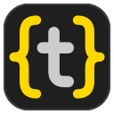
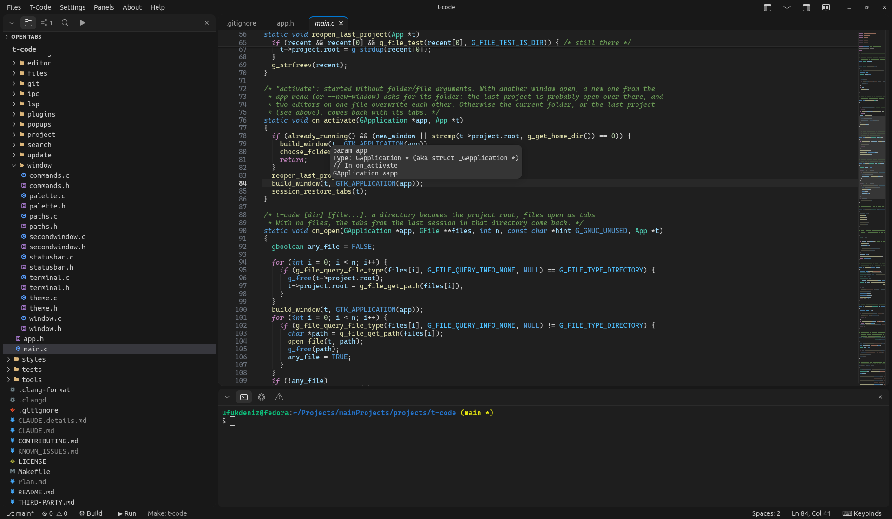

#  T-Code

A light C/C++ IDE for Linux in one GTK4 window, with a dark look (Dark Classic) and other color themes.

### Jump => [Latest Release v0.5.1](https://github.com/suacayipkisi/t-code/releases/tag/v0.5.1) | [Install](#install) | [Usage](#usage) | [Performance](#performance) | [All features](docs/features.md)



<sub>t-code 0.4: Dark Classic, rounded.</sub>

**New in 0.5.0:** a Testing panel, terminals as tabs, Mercurial and Subversion, a plugin registry with
fifteen plugins, a Process Monitor, t-code's own icons and quicker big repositories.

- Testing panel: CTest (with GoogleTest cases), pytest, go test, cargo test and JUnit (Maven, Gradle); run or debug one test,
  a group or all, ▶ in the editor gutter next to each test, a double click goes to its source
- Terminal tabs in the shell panel (`Ctrl+Shift+T`): the first one runs Build and Run, each can be renamed
- Source Control for Mercurial and Subversion repositories next to git, and the repositories nested in a project
- Plugins: browse and install them from the registry, a Plugins panel and menu, plugins that bring
  language servers, Run commands and snippets; new plugins for Java (jdtls), CMake, MATLAB, Octave,
  LaTeX / Typst, ShellCheck, Spell Check, Format on Save, TODO Finder, Targets, Commit Message Helper,
  Open on GitHub / GitLab, Pomodoro, Word Count and Text Tools
- Help: Process Monitor: CPU and memory of every language server, plugin and terminal t-code started
- File and interface icons drawn from t-code's own SVGs, in dark and light
- A welcome window when there is no folder to open
- Completion: Tab takes the proposal, Enter starts a new line
- Panels give way when their side narrows; dragging the edge of a hidden side opens it
- Big repositories: Source Control, Outline and the editor no longer stall on thousands of files
- Fix: Ctrl+J no longer brings back the Files panel Ctrl+B hid
- Fix: the shell and the right side keep their size in a small window instead of disappearing

**0.4.2** added a much fuller Markdown preview (TeX math, GitHub alerts, emoji, footnotes, mermaid),
images in tabs, a Hierarchy that follows the cursor and an autosave delay setting.

**0.4.0** added multiple cursors, replace across the project, snippets, inlay hints, Outline and call / type
hierarchy, and in git: branches, pull / fetch, stash, line blame and merge conflict buttons; more
language servers (JavaScript / TypeScript, JSON, YAML, Markdown, CMake). 

**0.3.1** added language servers for Python, Go and Rust, plugins, the Problems panel, project tasks, crash recovery and 
Flatpak / Snap / AUR / AppImage packages; 

**0.3** the debugger, quick fixes, folding, sticky scroll and color themes. 

**Next (0.6):** more of Mercurial and Subversion, and project templates.

## What it has

One window, one process (besides its language servers, your shell and plugins): the Files panel,
Source Control, Search and Run and Debug on the left, editor tabs in the middle, your shells as
tabs and the Problems panel at the bottom, Outline, Hierarchy and Testing on the right. Every panel
can be dragged to another dock.

- **Editing** without modes, plus multiple cursors, snippets, completion, parameter hints, inlay
  hints, go to definition, references, rename, format, quick fixes (also as buttons on a problem),
  folding, sticky scroll, breadcrumbs, colors by meaning, find and replace, a minimap and the git
  diff gutter; the Outline panel and call / type hierarchy.
- **Debugging** (`F5`) with gdb or lldb-dap (C, C++, Rust), debugpy (Python) and Delve (Go):
  breakpoints (with conditions), logpoints, stepping, variables, watch, call stack, values under the
  pointer, disassembly, a memory view; attaching to a running process, opening a core dump.
- **Build, Run and Test** in the shell: CMake, Meson, Make or a single C/C++ file; Cargo, Go, Node,
  Maven, Gradle, Python and scripts; or your own [project tasks](docs/tasks.md).
- **Testing panel**: CTest and GoogleTest, pytest, go test, cargo test and JUnit; run or debug a single
  test from the panel or the ▶ in the editor gutter.
- **Git**: Source Control panel (commit, push, pull, stage hunks), branches, stash, line blame,
  merge conflict buttons, compare with HEAD or a commit from the file's history, git colors in the
  Files panel, the repositories nested in a project. Mercurial and Subversion repositories work too
  (changes, commits, gutter, blame, history).
- **Search and replace** across files (ripgrep), a split editor, a second window, a native Markdown preview,
  crash recovery, autosave, [plugins](docs/plugins.md) from a registry, a Process Monitor, color themes and Settings.

Everything in detail, with the full key table: **[docs/features.md](docs/features.md)**.

### Language servers

Each starts when the first file of its language is shown and stops 30 seconds after the last one
closes. All but clangd are optional: t-code uses them when they are on `PATH`.

| Files | Server | Install |
|---|---|---|
| C, C++, Objective-C | `clangd` | the package's dependency |
| Python | `pylsp` (also from the project's venv) | `pipx install 'python-lsp-server[all]'`, plus `python-lsp-ruff` for quick fixes |
| Go | `gopls` | `GOTOOLCHAIN=auto go install golang.org/x/tools/gopls@latest` |
| Rust | `rust-analyzer` | `rustup component add rust-analyzer` |
| JavaScript, TypeScript | `typescript-language-server` | `npm install -g typescript-language-server typescript@6` |
| JSON | the JSON language server | `npm install -g vscode-langservers-extracted` |
| YAML | `yaml-language-server` | `npm install -g yaml-language-server` |
| Markdown | `marksman` | your distribution or its GitHub releases |
| CMake | `neocmakelsp` | `cargo install neocmakelsp` |
| Java | `jdtls`, through the Java plugin | install the plugin (Plugins → Browse the Registry… in the menu bar), then **Java: Install Language Server** (needs a JDK 21+) |

**Python: Select Interpreter…**, **Rust: Select Features…** and **Rust: Select Target…** (command
palette) set the project's Python, Cargo features and target for the server and for Build, Run and
Test. The JSON server only validates (no downloads, no formatting) and skips generated or big
files. More in [docs/features.md](docs/features.md#the-editor).

## Install

`t-code --version` prints the installed version.

The packages are named `t-code-ide`; the command stays `t-code` (in the Snap it is `t-code-ide`).

### Fedora (Copr)

```sh
sudo dnf copr enable suacayipkisi/t-code-ide
sudo dnf install t-code-ide
```

Fedora 43, 44 and rawhide; updates come with `dnf upgrade`.

### Ubuntu (PPA)

```sh
sudo add-apt-repository ppa:suacayipkisi/t-code-ide
sudo apt install t-code-ide
```

Ubuntu 26.04 and 26.10 (24.04's GtkSourceView is too old).

### Snap

```sh
sudo snap install t-code-ide
sudo snap alias t-code-ide t-code    # optional: run it as t-code
```

The Snap is strictly confined: it bundles its own compiler, clangd, gdb, CMake and Python, and sees
the projects in your home folder.

### Packages ([latest release](https://github.com/suacayipkisi/t-code/releases/tag/v0.4.2), x86_64)

```sh
sudo dnf install ./t-code-ide-0.4.2-1.fc44.x86_64.rpm        # Fedora 44
sudo pacman -U t-code-ide-0.4.2-1-x86_64.pkg.tar.zst         # Arch Linux
sudo apt install ./t-code-ide_0.4.2-1_amd64.deb              # Debian 13
xbps-rindex -a t-code-ide-0.4.2_1.x86_64.xbps && sudo xbps-install --repository="$PWD" t-code-ide   # Void (or x86_64-musl)
flatpak install --user ./t-code-0.4.2-x86_64.flatpak         # Flatpak
sudo snap install --dangerous ./t-code-ide_0.4.2_amd64.snap  # Snap (strict confinement)
```

The package manager pulls in clangd, git and the Cascadia Code font (Void has no Cascadia Code:
the system's monospace font is used). Releases no longer include an AppImage (`packaging/appimage.sh`
still builds one by hand). An AUR recipe is in `packaging/aur/` (`makepkg -si`). The
sandboxes' limits: [Flatpak](packaging/flatpak/README.md), [Snap](packaging/snap/README.md).
Building the packages yourself: [docs/packaging.md](docs/packaging.md).

### From the source

Needs `gcc` 14 (C23), `make` and the GTK4, GtkSourceView 5 (5.16+), json-glib, VTE and md4c
headers; at run time `clangd`, `git`, the Cascadia Code font, optionally `ripgrep`, `gdb` 14+ (or
`lldb-dap`), `debugpy` and `dlv`.

```sh
sudo dnf install gtk4-devel gtksourceview5-devel json-glib-devel vte291-gtk4-devel md4c-devel
packaging/install.sh      # builds and installs into ~/.local (packaging/uninstall.sh removes it)
```

`make` builds `build/t-code`, `make test` runs the tests, `make install` installs system-wide.
More in [CONTRIBUTING.md](CONTRIBUTING.md).

## Usage

```sh
t-code            # current directory
t-code path/dir
t-code a.c b.c    # open files as tabs
```

The **Keybinds** button in the status bar lists every key, and `Ctrl+Shift+P` finds any command.
The ones to know first:

| Key | Action |
|---|---|
| `Ctrl+P` / `Ctrl+Shift+F` / `Ctrl+Shift+P` | open a file / search all files / command palette |
| `Ctrl+Shift+B` / `Ctrl+F5` / `F5` | build / build and run / debug |
| `F12` / `Shift+F12` / `F2` / `Ctrl+.` | go to definition / references / rename / quick fix |
| `Ctrl+Shift+M` / `Ctrl+Shift+G` | Problems / Source Control |
| `Ctrl+\` / `Ctrl+B` / `Ctrl+J` | split the editor / Files panel / shell |
| click / double click a file | open in a temporary tab / keep it open |

The full table: [docs/features.md](docs/features.md#keys).

## Plugins

Plugins are separate programs, started only when one of their commands runs, so an idle plugin
costs nothing. They live in `~/.config/t-code/plugins/<id>/` with a `plugin.json` manifest and talk
to t-code over `$TCODE_SOCKET`. A plugin runs with your user's rights: install only ones you trust.
**Plugins: Manage Plugins** (command palette, or the Plugins menu in the menu bar) lists them: turn one off, start or stop it, read what
it printed, uninstall it. **Help: Process Monitor** shows what each plugin, language server and terminal
uses (CPU, memory). The manifest, environment and socket protocol:
[docs/plugins.md](docs/plugins.md); examples are in `plugins/builtin/`, written in different languages (Python, Rust, C, C++, Go, JavaScript, Perl) on purpose, to test
that the plugin API works from any of them.

## Creating a Plugin

If you are interested in writing a plugin for t-code, all types of plugins will be gladly accepted. However, you also 
have to consider the main idea of t-code's existence, which is as low resource usage as possible. Because of that I highly 
recommend writing the plugin in the C language, which is the language t-code is written in. You can also use AI. Also, the 
plugin must be safe.

## Contributing

If you want to contribute, all contributions will be gladly accepted. Please read
[`CONTRIBUTING.md`](CONTRIBUTING.md) and open a pull request.  
AI usage is strictly forbidden for contributing anymore. However you can open a discussiın and explain the issue and the 
way to solve which is found with using AI. You can use AI for asking help and template. 

## AI Usage in Project  

Most of the structure and code written with using AI coding agent. Every single line of code is reviewed or currently 
under review. I did not spend enough time to write just myself because I just want an ide that uses not much ram as 
immediately as possible, the editor I used was using too much then I got angry and tada... BUT I will review every 
detail of this project and after than I will continue to add new features as I wish.

## Why You Use An IDE Instead Of Using Just AI

Of course I use AI to write some parts of the stuff. The main idea is not doing the job, the idea is having fun. Think like 
that, your friend is playing a game and you alsa want to play it. Other friend says, "Why would you play the game, just watch 
your friend". And saying that IDE is not necessary is something like that. If I need to write code fast, I probably just use AI. 
-and you can see this IDE is written with AI coding agent mostly because I want to reach result fast-.
However, I do not write code for just doing job. I'm writing code as a hobby, thinking and writing code is fun to me. Also I want to 
learn more and more detail about computers and I want to try how deep can I go. For learning, you need to write code by yourself.
And you can ask why you are not using other popular IDEs. The main reason is the most important property of this IDE, low 
resource usage! Especially RAM usage. The second reason is they are not adding the propertiees that I want. I think waiting them 
to adding new features in their IDE is takes more time than making it myself using AI agent.

## Performance

Measured on Fedora 44 (0.5.0: Fedora 45, clangd 23) with the same 25 C files of this repository
open, each tab shown in turn (`tools/measure.sh`; PSS, so the rows add up):

| all 25 tabs shown | 0.1.1 (micro) | 0.2 (GtkSourceView) | 0.3 | 0.4.1 | 0.5.0 |
|---|---:|---:|---:|---:|---:|
| editors | 25 micro processes, 412 MB | in the window | in the window | in the window | in the window |
| t-code window | 57 MB | 83 MB | 70 MB | 70–72 MB | 70–76 MB |
| helper processes per editor | 50, 6 MB | none | none | none | none |
| clangd | 361 MB | 470 MB | 345–367 MB | 372–392 MB | 372–416 MB |
| **memory in all** | **839 MB** | **557 MB** | **418–442 MB** | **445–467 MB** | **445–495 MB** |

RSS, which counts shared libraries in full, for 0.5.0: window 111–112 MB, clangd 419–442 MB.
On Fedora 45 the same day, 0.4.2 measured 89–90 MB for the window, 394–532 MB for clangd and
487–625 MB in all, so 0.5.0 is smaller than the release before it on the same system.

clangd gets a file only once its tab is shown, keeps at most five open, runs with two malloc
arenas and stops when its last file closes; idle, t-code uses no CPU. What keeps it small and how
to measure it yourself: [docs/performance.md](docs/performance.md).

## License

MIT, see [LICENSE](LICENSE). The color themes' and language servers' sources and licenses are in
[THIRD-PARTY.md](THIRD-PARTY.md).

## Contributors

- [@suacayipkisi](https://github.com/suacayipkisi) — Creator & Lead Maintainer
- [@dontworryplz](https://github.com/dontworryplz) — Plugin system, unified problems panel, tasks runner, crash recovery, Flatpak, Snap & AUR packaging (includes highly AI usage)
