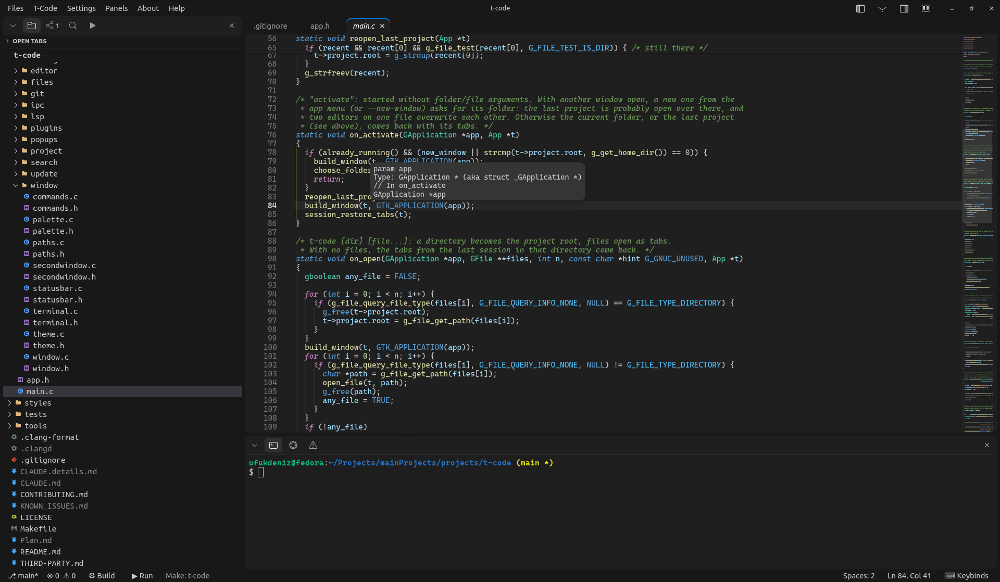

#  T-Code

A light C/C++ IDE for Linux in one GTK4 window, with a dark look (Dark Classic) and other color themes.

### Jump => [Latest Release v0.3.2](https://github.com/suacayipkisi/t-code/releases/tag/v0.3.2) | [Install](#install) | [Usage](#usage) | [Performance](#performance) | [All features](docs/features.md)




<sub>t-code 0.3: Dark Classic, rounded (top) and Gruvbox, square (bottom).</sub>

**New in 0.3.2:** fixes for the update release URL launcher and clangd compile command flag escaping.
**0.3.1** added language servers for Python, Go and Rust, plugins, the Problems panel, project
tasks, crash recovery and Flatpak / Snap / AUR / AppImage packages; **0.3** the debugger, quick
fixes, folding, sticky scroll and color themes. **Next (0.4):** terminals as tabs in the shell panel.

## What it has

One window, one process (besides its language servers, your shell and plugins): the Files panel,
Source Control, Search and Run and Debug on the left, editor tabs in the middle, your shell and
the Problems panel at the bottom. Every panel can be dragged to another dock.

- **Editing** without modes, plus completion, parameter hints, go to definition, references,
  rename, format, quick fixes (also as buttons on a problem), folding, sticky scroll, colors by
  meaning, find and replace, a minimap and the git diff gutter.
- **Debugging** with gdb (`F5`): breakpoints (with conditions), stepping, variables, watch, call
  stack, values under the pointer, disassembly.
- **Build, Run and Test** in the shell: CMake, Meson, Make or a single C/C++ file; Cargo, Go, Node,
  Maven, Gradle, Python and scripts; or your own [project tasks](docs/tasks.md).
- **Git**: Source Control panel (commit, push, stage hunks), compare with HEAD or a commit from the
  file's history, git colors in the Files panel.
- **Search** across files (ripgrep), a split editor, a second window, a native Markdown preview,
  crash recovery, autosave, [plugins](docs/plugins.md), color themes and Settings.

Everything in detail, with the full key table: **[docs/features.md](docs/features.md)**.

### Language servers

Each starts when the first file of its language is shown and stops a minute after the last one
closes. All but clangd are optional: t-code uses them when they are on `PATH`.

| Files | Server | Install |
|---|---|---|
| C, C++ | `clangd` | the package's dependency |
| Python | `pylsp` (also from the project's venv) | `pip install python-lsp-server` |
| Go | `gopls` | `go install golang.org/x/tools/gopls@latest` |
| Rust | `rust-analyzer` | `rustup component add rust-analyzer` |
| JavaScript, TypeScript | `typescript-language-server` | `npm install -g typescript-language-server typescript` |
| JSON | the JSON language server | `npm install -g vscode-langservers-extracted` |
| YAML | `yaml-language-server` | `npm install -g yaml-language-server` |
| Markdown | `marksman` | your distribution or its GitHub releases |

**Python: Select Interpreter…**, **Rust: Select Features…** and **Rust: Select Target…** (command
palette) set the project's Python, Cargo features and target for the server and for Build, Run and
Test. The JSON server only validates (no downloads, no formatting) and skips generated or big
files. More in [docs/features.md](docs/features.md#the-editor).

## Install

`t-code --version` prints the installed version.

### Packages ([latest release](https://github.com/suacayipkisi/t-code/releases/tag/v0.3.2), x86_64)

```sh
sudo dnf install ./t-code-0.3.2-1.fc44.x86_64.rpm        # Fedora 44
sudo pacman -U t-code-0.3.2-1-x86_64.pkg.tar.zst         # Arch Linux
sudo apt install ./t-code_0.3.2-1_amd64.deb              # Debian 13
xbps-rindex -a t-code-0.3.2_1.x86_64.xbps && sudo xbps-install --repository="$PWD" t-code   # Void (or x86_64-musl)
flatpak install --user ./t-code-0.3.2-x86_64.flatpak     # Flatpak
sudo snap install --dangerous ./t-code_0.3.2_amd64.snap  # Snap (strict confinement)
```

The package manager pulls in clangd, git and the Cascadia Code font (Void has no Cascadia Code:
the system's monospace font is used). The **AppImage** bundles t-code with its libraries and takes
`clangd` and `git` from the system. An AUR recipe is in `packaging/aur/` (`makepkg -si`). The
sandboxes' limits: [Flatpak](packaging/flatpak/README.md), [Snap](packaging/snap/README.md).
Building the packages yourself: [docs/packaging.md](docs/packaging.md).

### From the source

Needs `gcc` 14 (C23), `make` and the GTK4, GtkSourceView 5 (5.16+), json-glib, VTE and md4c
headers; at run time `clangd`, `git`, the Cascadia Code font, optionally `ripgrep` and `gdb` 14+.

```sh
sudo dnf install gtk4-devel gtksourceview5-devel json-glib-devel vte291-gtk4-devel md4c-devel
packaging/install.sh      # builds and installs into ~/.local (packaging/uninstall.sh removes it)
```

`make` builds `build/t-code`, `make test` runs the tests, `make install` installs system-wide.
More in [CONTRIBUTING.md](CONTRIBUTING.md).

## Usage

```sh
t-code            # current directory
t-code path/dir
t-code a.c b.c    # open files as tabs
```

The **⌨ Keybinds** button in the status bar lists every key, and `Ctrl+Shift+P` finds any command.
The ones to know first:

| Key | Action |
|---|---|
| `Ctrl+P` / `Ctrl+Shift+F` / `Ctrl+Shift+P` | open a file / search all files / command palette |
| `Ctrl+Shift+B` / `Ctrl+F5` / `F5` | build / build and run / debug |
| `F12` / `Shift+F12` / `F2` / `Ctrl+.` | go to definition / references / rename / quick fix |
| `Ctrl+Shift+M` / `Ctrl+Shift+G` | Problems / Source Control |
| `Ctrl+\` / `Ctrl+B` / `Ctrl+J` | split the editor / Files panel / shell |
| click / double click a file | open in a temporary tab / keep it open |

The full table: [docs/features.md](docs/features.md#keys).

## Plugins

Plugins are separate programs, started only when one of their commands runs, so an idle plugin
costs nothing. They live in `~/.config/t-code/plugins/<id>/` with a `plugin.json` manifest and talk
to t-code over `$TCODE_SOCKET`. A plugin runs with your user's rights: install only ones you trust.
The manifest, environment and socket protocol: [docs/plugins.md](docs/plugins.md); an example is
in `plugins/word-count`.

## Creating a Plugin

If you are interested in writing a plugin for t-code, all types of plugins will be gladly accepted. However, you also have to consider the main idea of t-code's existence, which is as low resource usage as possible. Because of that I highly recommend writing the plugin in the C language, which is the language t-code is written in. You can also use AI. Also, the plugin must be safe.

## Contributing

If you want to contribute, all contributions will be gladly accepted. Please read
[`CONTRIBUTING.md`](CONTRIBUTING.md) and open a pull request.

## AI Usage in Project  

Most of the structure and code written with using AI coding agent. Every single line of code is reviewed or currently under review. I did not spend enough time to write just myself because I just want an ide that uses not much ram as immediately as possible, the editor I used was using too much then I got angry and tada... BUT I will review every detail of this project and after than I will continue to add new features as I wish.

## Performance

Measured on Fedora 44 with the same 25 C files of this repository open, each tab shown in turn
(`tools/measure.sh`; PSS, so the rows add up):

| all 25 tabs shown | 0.1.1 (micro) | 0.2 (GtkSourceView) | 0.3 | 0.3.2 |
|---|---:|---:|---:|---:|
| editors | 25 micro processes, 412 MB | in the window | in the window | in the window |
| t-code window | 57 MB | 83 MB | 70 MB | 66–70 MB |
| helper processes per editor | 50, 6 MB | none | none | none |
| clangd | 361 MB | 470 MB | 345–367 MB | 366–370 MB |
| **memory in all** | **839 MB** | **557 MB** | **418–442 MB** | **436–441 MB** |

clangd gets a file only once its tab is shown, keeps at most five open, runs with two malloc
arenas and stops when its last file closes; idle, t-code uses no CPU. What keeps it small and how
to measure it yourself: [docs/performance.md](docs/performance.md).

## License

MIT, see [LICENSE](LICENSE). The color themes' and language servers' sources and licenses are in
[THIRD-PARTY.md](THIRD-PARTY.md).

## Contributors

- [@suacayipkisi](https://github.com/suacayipkisi) — Creator & Lead Maintainer
- [@dontworryplz](https://github.com/dontworryplz) — Plugin system, unified problems panel, tasks runner, crash recovery, Flatpak, Snap & AUR packaging
